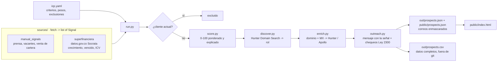

# oraculo-callbook

Herramienta de prospección B2B para **Callbook AI** (cobranza de cartera tardía con agentes de IA, YC S26). Convierte señales públicas en una lista priorizada de prospectos, con el puntaje explicado, los decisores con correo corporativo y un primer mensaje listo para enviar.

Es modular: otra empresa la usa cambiando `oraculo/icp.yaml` y `data/signals.json`.

## El problema

Las entidades de crédito masivo en Colombia (BNPL, microcrédito, tarjetas, neobancos) crecen su cartera rápido, y ese crecimiento llega a mora tardía 12 a 18 meses después. Saber **a quién** llamar primero y **con qué argumento** hoy depende de leer prensa, vacantes y cifras de la Superfinanciera a mano. El oráculo junta esas señales, las pondera con criterios explícitos y deja lista la conversación.

## Pipeline



| Módulo | Qué hace |
|---|---|
| `oraculo/icp.yaml` | Vendedor, vertical, país, criterios y pesos, clientes a excluir, fuentes activas, plantilla de mensaje y ventana de envío. |
| `oraculo/sources/` | Una fuente por archivo, todas con `fetch(cfg, icp) -> list[Signal]`. `run.py` las carga por nombre desde `icp.yaml`. Si una fuente falla, el pipeline sigue y lo registra en `fuentes` del JSON. |
| `sources/manual_signals.py` | Lee `data/signals.json`: perfil de la empresa, decisores, señales con fuente y la calificación del analista con su porqué. |
| `sources/superfinanciera.py` | Dataset `rvii-eis8` ("Distribución de cartera por producto", mensual). Suma consumo (UNICAP 1-6, 29, 30) y microcrédito (7, 8) en el renglón total; compara con el mismo mes del año anterior; calcula saldo vencido (saldo − vigente) e ICV. Convierte crecimiento y tamaño en una calificación 1-5 (la menor de las dos, para que una base pequeña que crece 1.000 % no saque 5). |
| `score.py` | Puntaje = Σ peso × (calificación − 1) / 4, normalizado a 100. Cada criterio devuelve calificación, puntos, origen (Superfinanciera o analista), porqué y evidencia. Si hay dato cuantitativo, prevalece sobre el analista (`cuantitativo_prevalece`). |
| `enrich.py` | Dominio de la empresa → validación MX (dnspython) → Hunter Email Finder o Apollo `people/match`. Devuelve correo, confianza (alta/media/baja), fuente y `linkedin_url`. Nunca inventa correos: sin respuesta, queda vacío. Solo acepta correos del dominio corporativo. El único teléfono es el PBX corporativo. Marca en `revisar` los casos que necesitan una persona: cargo del proveedor distinto al nuestro (posible homónimo; baja la confianza a "baja") y dominios `accept_all` (correo inferido por patrón). Guarda las respuestas en `out/.enrich_cache.json` para no gastar créditos al repetir. |
| `discover.py` | Antes de enrich: Hunter Domain Search por dominio (caché y tope de llamadas en `descubrimiento.max_llamadas`), filtro por palabras clave del cargo, rol (decisor, aprobador o influenciador, reglas en `icp.yaml`) y cruce con los decisores conocidos: confirmado, descubierto o posible coincidencia. Si enrich no trae correo para un decisor confirmado, usa el de Domain Search. |
| `outreach.py` | Primer mensaje desde la plantilla del YAML con el `gancho` (la señal concreta) de cada prospecto, chequeos de cumplimiento y la primera ventana de envío permitida (hora de Bogotá). |
| `run.py` | CLI. Escribe `out/prospects.json` (público, enmascarado) y su copia `public/prospects.json`, más `out/prospects_full.json` y `out/prospects.csv` (completos, ignorados por git). |

## Cómo correrlo

```bash
python3 -m venv .venv && source .venv/bin/activate
pip install -r requirements.txt
cp .env.example .env            # pon HUNTER_API_KEY y/o APOLLO_API_KEY

python -m oraculo.run --icp icp.yaml                  # todo el pipeline
python -m oraculo.run --icp icp.yaml --no-enrich      # sin enriquecer
python -m oraculo.run --icp icp.yaml --solo-cache     # enriquece solo con lo ya consultado (0 créditos)
python -m oraculo.run --icp icp.yaml --sources manual_signals   # solo algunas fuentes

# Enriquecer personas sueltas:
python -m oraculo.enrich "Jessica Alvira:Addi:addi.com" "Natalia Serna:Tuya:tuya.com.co"

# Demo local
python -m http.server 8000 -d public
open http://localhost:8000/

# Despliegue en Cloudflare Workers (assets estáticos desde public/, ver wrangler.toml)
npx wrangler deploy
```

La demo lee `./prospects.json` (o `?data=<url>`), que `run.py` copia en `public/` en cada corrida. Los pesos se mueven en vivo; el ranking y el titular se recalculan con la misma fórmula que `score.py`.

## Cómo adaptarlo a otra vertical en 5 minutos

1. **`oraculo/icp.yaml`**: cambia `vendedor`, `vertical`, `pais`, los `criterios` (clave, nombre, peso) y la lista `excluir` con tus clientes actuales.
2. **`data/signals.json`**: una entrada por empresa con `dominio`, `gancho`, `decisores`, `senales` (cada una con `fuente` y `url`) y `calificaciones` por criterio (`[1-5, "porqué"]`).
3. **Fuentes**: apaga `superfinanciera` en `fuentes:` si tu vertical no es financiera, o crea `oraculo/sources/<nombre>.py` con `fetch(cfg, icp) -> list[Signal]` y agrégalo a `fuentes:`. Una señal con `cuantitativa=True` y `calificacion` reemplaza la del analista en su criterio.
4. **`mensaje.plantilla`**: ajusta la propuesta; las variables son `{nombre}`, `{gancho}`, `{empresa_vendedor}`, `{descripcion_vendedor}`, `{remitente}`, `{cargo}`, `{url_baja}`.
5. Corre `python -m oraculo.run --icp icp.yaml` y abre la demo.

## Cumplimiento

**Ley 1581 de 2012 (datos personales).** Solo datos de contacto corporativos y públicos en contexto profesional: correo del dominio de la empresa (los correos personales se descartan) y PBX corporativo, nunca celulares personales. Cada señal guarda su fuente. Los datos completos viven en `out/prospects.csv` y `out/prospects_full.json`, fuera de git; la demo y `out/prospects.json` enmascaran los correos (`j***@addi.com`). Toda persona puede pedir la baja y la supresión de sus datos.

**Ley 2300 de 2023.** Aunque regula el contacto con consumidores y esto es B2B, el oráculo la aplica como estándar: canal corporativo, máximo un contacto por semana por canal, envío solo de lunes a viernes de 7:00 a 19:00 y sábados de 8:00 a 15:00 (nunca domingos ni festivos; agrega los festivos en `mensaje.festivos`), identificación clara del remitente, motivo del contacto, opción de baja y sin lenguaje de presión. `outreach.py` deja el resultado de cada regla en `mensaje.cumplimiento`.

> **Plantillas que configura el cliente.** `vendedor.correo_remitente` (`ejemplo@callbook.ai`) y `vendedor.url_baja` (`https://callbook.ai/ejemplo-baja`) en `icp.yaml` son valores de ejemplo. Cada empresa que use el oráculo pone su buzón y su enlace de baja reales antes de enviar.

## Resultados de la corrida 2026-11-24

Pesos por defecto de `icp.yaml` (cartera 25, dolor 25, similitud 20, inclusión 15, IA 15).

| # | Empresa | Cartera | Dolor | Similitud | Inclusión | IA | Puntaje | Origen de "cartera" |
|---|---|---|---|---|---|---|---|---|
| 1 | Addi | 5 | 5 | 5 | 4 | 5 | **96** | Analista (no reporta en el dataset) |
| 2 | Mibanco Colombia | 5 | 4 | 5 | 5 | 3 | **86** | Superfinanciera (analista: 4) |
| 3 | Tuya | 4 | 4 | 4 | 4 | 5 | **79** | Superfinanciera |
| 4 | Nu Colombia | 5 | 3 | 3 | 4 | 5 | **74** | Superfinanciera |
| 5 | RappiPay | 3 | 4 | 3 | 3 | 4 | **60** | Superfinanciera |

Superfinanciera, dataset [`rvii-eis8`](https://www.datos.gov.co/d/rvii-eis8) (Distribución de cartera por producto), corte **2026-09-30** contra 2025-09-30. Consumo + microcrédito; COP.

| Entidad (nombre SFC) | Saldo | Crecimiento anual | Saldo vencido | ICV | Calificación |
|---|---|---|---|---|---|
| Mibanco S.A. | $2,68 billones (99,9 % microcrédito) | +47,9 % | $127,2 mil millones | 4,74 % | 5 |
| Tuya | $2,23 billones | +15,3 % | $108,6 mil millones | 4,86 % | 4 |
| Nu O Nu Financiera | $3,96 billones | +79,9 % | $143,9 mil millones | 3,63 % | 5 |
| "Rappipay" | $217,0 mil millones | +1.043,9 % | $6,4 mil millones | 2,96 % | 3 (limitada por tamaño) |

Enriquecimiento (Hunter) de los seis decisores de Addi, Mibanco y Tuya: 2 correos verificados (Addi), 4 inferidos por patrón en dominios `accept_all` (Mibanco, Tuya). El correo de Natalia Serna (Tuya) quedó en confianza baja: Hunter la asocia con otro cargo y hay que confirmar en LinkedIn antes de contactarla. Los correos completos no están en el repo.

### Descubiertos por el oráculo (Hunter Domain Search)

3 llamadas (addi.com, mibanco.com.co, tuya.com.co), 10 resultados por dominio, filtrados por cargo. Sin correos en el repo.

| Empresa | Nombre | Cargo (Hunter) | Rol | Confianza | Estado |
|---|---|---|---|---|---|
| Addi | Jayesh Ametha | Chief Credit Officer | aprobador | alta (95, verificado) | descubierto |
| Addi | Juan Iranzo | Chief Financial Officer | aprobador | alta (95, verificado) | descubierto |
| Addi | Ravish Sharma | Director of Credit Risk | decisor | alta (95, verificado) | descubierto |
| Addi | Jessica Alvira | Collections Manager | decisor | alta (95, verificado) | confirmado |
| Mibanco | Juan Llano | Vice President of Finance | aprobador | media (78, accept_all) | descubierto |
| Mibanco | Jorge Borrero | Vice President of Risk | aprobador | media (79, accept_all) | confirmado |
| Mibanco | Gerardo Hernández Huertas | Collections Manager | decisor | media (79, accept_all) | confirmado |
| Mibanco | Jose Castro | Financial Advisor | influenciador | media (85, verificado) | descubierto |
| Mibanco | Solange Sánchez | Head of Financial Crime Prevention | influenciador | media (84) | descubierto |
| Tuya | Jose Guzmán | Chief Financial Officer | aprobador | media (78) | descubierto |

En Tuya, Domain Search no devolvió cargos de cobranza ni riesgo; Natalia Serna y Juan Diego Giraldo siguen sin confirmar.

## Estado y pendientes

- **Superfinanciera**: funcionando en vivo para Mibanco, Tuya, Nu y RappiPay (corte 2026-09-30). **Addi no aparece** en el dataset `rvii-eis8`; su criterio de cartera sigue siendo del analista. Pendiente: confirmar con qué nombre reporta (o si reporta en otro formato) y agregarlo en `fuentes.superfinanciera.entidades`.
- **PBX**: `pbx` está vacío en `signals.json`; hay que llenarlo con el conmutador corporativo publicado por cada empresa.

## Siguiente fase (arquitectura prototipada en equipo en una hackathon de GTM)

- **`enrich_company`**: URL de la empresa → Firecrawl → LLM → puntaje ICP validado con esquema (Pydantic aquí, Zod en el prototipo), para cubrir empresas que no vigila la Superfinanciera.
- **`persona_angle`**: cargo y publicaciones públicas del decisor → dolor de su área y ángulo de venta.
- **`ask.py`**: modo de un solo prompt; ver la sección siguiente.
- **`sequence`**: secuencia de primer contacto (canal, momento, mensaje) que cumple la Ley 2300: solo en horarios permitidos y un canal por semana.
- **Scraper de vacantes**: fuente `sources/vacantes.py` (LinkedIn Jobs, Computrabajo, Magneto) para cargos de cobranza; una vacante de cobranza es una señal de dolor con fecha.
- **Prensa**: fuente `sources/prensa.py` sobre RSS de Valora Analitik, Portafolio, La República y LatamFintech, con extracción de cifras de colocación y venta de cartera.
- **Sincronización con el CRM**: exportar prospectos, decisores y mensaje a HubSpot o Pipedrive, con deduplicación por dominio y el registro de contactos por semana para hacer cumplir el límite de la Ley 2300.
- **Corrida semanal con alertas**: correr el oráculo cada semana (cron o GitHub Actions) y avisar cuando un prospecto suba en el ranking.

## Modo de un solo prompt (siguiente fase)

- **Key**: en `.env`, `ANTHROPIC_API_KEY` (ver `.env.example`; es opcional y solo habilita `oraculo.ask`).
- **Uso**:
  ```bash
  python -m oraculo.ask "fintechs de crédito de consumo en Colombia para una agencia de cobranza con IA"
  ```
- **Flujo**: prompt → el LLM genera un `icp.yaml` validado con Pydantic → fuentes de señales → score → discover → enrich → outreach → `out/prospects.json`.
- **Estado**: no implementado; requiere la key.
